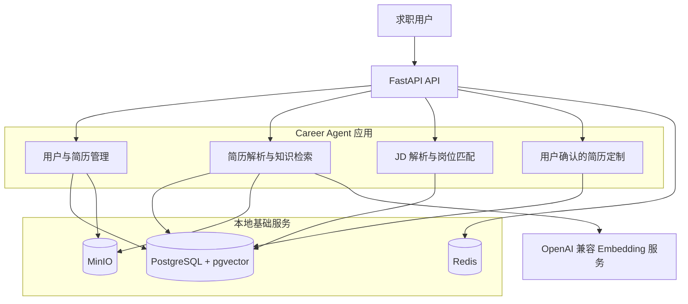
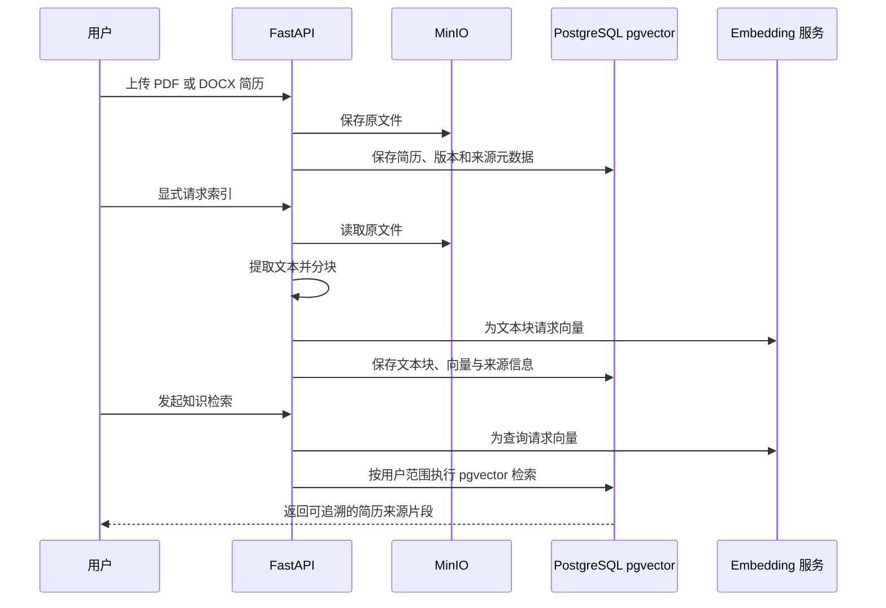
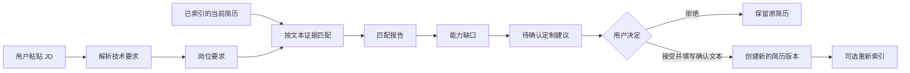

# Career Agent

Career Agent 是一个面向技术类求职场景的可信智能求职系统。它以用户确认的真实简历内容为唯一事实来源，帮助用户保存简历、解析文本、理解岗位要求、获得可追溯的匹配结论，并在用户确认后创建面向目标岗位的简历新版本。

系统不会自动抓取招聘网站，也不会把模型或规则的推断直接写成用户经历。任何进入新简历版本的补充内容，都必须由用户亲自确认。

## 总体架构



| 组件 | 主要职责 |
| --- | --- |
| FastAPI | 提供用户、简历、索引、岗位匹配和简历定制 API。 |
| PostgreSQL + pgvector | 保存业务数据、简历版本、文本块、向量、岗位要求、匹配证据与确认记录。 |
| Redis | 为后续缓存和短期任务状态保留的本地基础服务。 |
| MinIO | 保存上传的 PDF / DOCX 简历原文件。 |
| Embedding 服务 | 将用户显式索引的简历文本转换为向量，用于语义检索。 |

## 核心流程

### 简历上传与知识检索



### 岗位匹配与简历定制



岗位匹配首版使用确定性规则。只有在用户简历文本中找到明确证据时，系统才会记录为“已匹配”；没有证据的要求会形成能力缺口。匹配得分仅反映当前简历文本的证据覆盖度，不是录用概率，也不能替代人工判断。

## 本地启动

本项目使用 Docker Compose 启动开发依赖：

| 服务 | 用途 | 本机地址 |
| --- | --- | --- |
| PostgreSQL + pgvector | 业务数据与向量检索 | `localhost:5432` |
| Redis | 缓存和短期任务状态 | `localhost:6379` |
| MinIO | 简历与项目资料等对象文件 | API：`http://localhost:9000`；控制台：`http://localhost:9001` |

MinIO 使用 Quay 上的固定镜像摘要，以避免 Docker Hub 上该历史公开镜像的访问限制。

### 1. 准备环境变量

首次使用时复制环境变量模板并填入本机开发密码。`.env` 包含密码和 API Key，不应提交到 Git：

```powershell
Copy-Item .env.example .env
```

若需要使用语义索引与检索，请在 `.env` 中配置 `EMBEDDING_API_KEY`、`EMBEDDING_BASE_URL`、`EMBEDDING_MODEL` 与 `EMBEDDING_DIMENSIONS`。

### 2. 启动 Docker 基础服务

确保 Docker Desktop 已启动，然后在项目根目录执行：

```powershell
docker compose up -d
docker compose ps
```

可验证三项服务与 pgvector 扩展：

```powershell
docker compose exec postgres psql -U career_agent -d career_agent -c "SELECT extname FROM pg_extension WHERE extname = 'vector';"
docker compose exec redis redis-cli ping
Invoke-WebRequest -UseBasicParsing -Uri "http://localhost:9000/minio/health/live"
```

预期结果分别为 `vector`、`PONG` 与 HTTP `200`。

### 3. 激活 Python 环境并执行迁移

```powershell
conda activate career-agent
cd G:\Catcher
alembic upgrade head
alembic current
```

### 4. 启动 API

```powershell
fastapi dev src/career_agent/api/main.py
```

在另一个终端验证服务：

```powershell
Invoke-RestMethod http://127.0.0.1:8000/health
```

预期结果：

```text
status database
------ --------
ok     available
```

交互式 API 文档：<http://127.0.0.1:8000/docs>

## 常用命令

```powershell
# 运行自动化测试
python -m pytest -q

# 静态检查
python -m ruff check .
python -m pyright --pythonpath C:\Users\admin\miniconda\envs\career-agent\python.exe

# 停止基础服务，保留 Docker 数据卷
docker compose down
```

`docker compose down` 不会删除本地数据。只有在明确需要清空数据库、缓存和对象存储的本地开发数据时，才使用 `docker compose down -v`。
